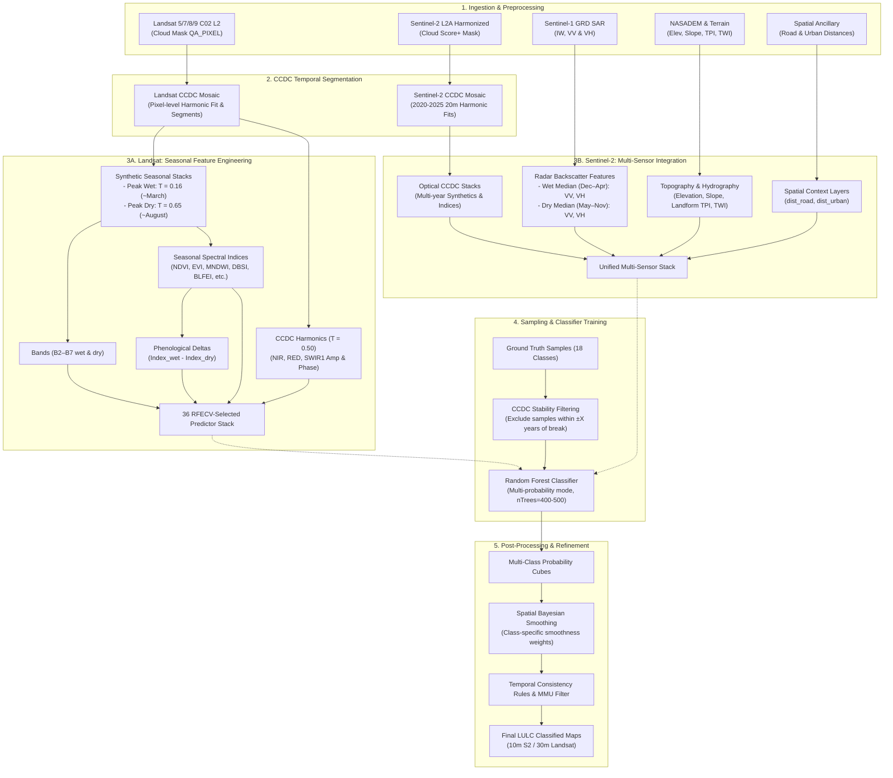

# Land Cover Classification Workflow — AI Agent Context

This document provides a comprehensive operational summary of the land use/land cover (LULC) classification workflows for Timor-Leste in Google Earth Engine (GEE). It is structured specifically as high-signal context for AI agents working on code generation, pipeline optimization, and multi-temporal analysis within this repository.

---

## 1. Executive Summary & Comparative Strategy

The pipeline generates wall-to-wall LULC classifications across an 18-class hierarchical schema for target years (e.g., 2005, 2015, 2020, and 2025). The architecture branches into two distinct sensor paradigms:

| Feature / Dimension | Landsat Pipeline (30 m) | Sentinel-2 Pipeline (10–20 m) |
|---|---|---|
| **Core Methodological Focus** | **Seasonal Phenological Feature Engineering** | **Multi-Sensor & Ancillary Integration** |
| **Primary Sensors** | Landsat 5/7/8/9 Collection 2 Level-2 | Sentinel-2 L2A (Harmonized) + Sentinel-1 GRD C-Band SAR |
| **Temporal Segmentation** | Continuous Change Detection & Classification (CCDC 2000–2025) | CCDC (2020–2025) + Google Global CCDC (1999–2019) |
| **Feature Extraction Engine** | On-the-fly CCDC synthetic reconstruction at seasonal fractions ($T_{\text{wet}}=0.16$, $T_{\text{dry}}=0.65$) | Multi-sensor raster fusing: S2 CCDC + S1 SAR + NASADEM + Proximity layers |
| **Key Predictors** | Seasonal reflective bands, seasonal spectral indices, phenological index deltas ($\Delta_{\text{wet}-\text{dry}}$), CCDC harmonics | S2 CCDC synthetics, S1 seasonal VV/VH backscatter, DEM, Slope, TPI landform, TWI, road/urban distance |
| **Feature Dimension** | 36 RFECV-optimized predictors | High-dimensional multi-sensor stack |
| **Classifier** | Random Forest (`MULTIPROBABILITY` mode, 500 trees) | Random Forest (`MULTIPROBABILITY` mode, 400–500 trees) |
| **Post-Processing** | Spatial Bayesian smoothing + Argmax | Spatial Bayesian smoothing + MMU filter + Temporal consistency rules |

---

## 2. End-to-End Workflow Graph



---

## 3. Landsat Workflow: Seasonal Feature Engineering

### 3.1. Philosophy & Objective
Landsat's lower spatial resolution (30 m) is compensated by exploiting its long temporal record and high phenological sensitivity. In Timor-Leste's tropical monsoonal climate, vegetation types (e.g., deciduous vs. evergreen forests, agroforestry vs. seasonal grasslands, paddy fields vs. cleared land) exhibit strong seasonal trajectories.

### 3.2. Step-by-Step Architecture

1. **Fractional Year Targeting**:
   - **Wet Season Fraction**: $T_{\text{wet}} = \text{Year} + 0.16$ (~March, peak monsoonal greenness and soil moisture).
   - **Dry Season Fraction**: $T_{\text{dry}} = \text{Year} + 0.65$ (~August, maximum vegetation senescence and dry spectral contrast).
   - **Harmonics Fraction**: $T_{\text{harm}} = \text{Year} + 0.50$ (mid-year active CCDC segment evaluation).

2. **EECU-Optimized Single Synthetic Reconstruction**:
   - Rather than querying CCDC model coefficients repeatedly per band/index, a single synthetic surface reflectance stack is reconstructed once for wet season and once for dry season via `ccdc_module.getSyntheticLandsatStack(ccdc, t, false, tol, coefScale)`.

3. **Feature Generation**:
   - **Seasonal Bands (12 features)**:
     - Wet: `B2_wet`, `B3_wet`, `B4_wet`, `B5_wet`, `B6_wet`, `B7_wet`
     - Dry: `B2_dry`, `B3_dry`, `B4_dry`, `B5_dry`, `B6_dry`, `B7_dry`
   - **Seasonal Spectral Indices (14 features)**:
     - Computed directly from synthetic reflectance: `BLFEI`, `DBSI`, `EVI`, `GBNDVI`, `MBI`, `MNDWI`, `MSAVI`, `NDMI`, `NDVI`.
   - **Phenological Delta Indices (6 features)**:
     - Difference between wet and dry indices captures intra-annual dynamic amplitude:
       $$\text{Index}_{\Delta} = \text{Index}_{\text{wet}} - \text{Index}_{\text{dry}}$$
       Features: `BLFEI_delta`, `DBSI_delta`, `MBI_delta`, `MNDWI_delta`, `MSAVI_delta`, `NDMI_delta`.
   - **CCDC Segment Harmonics (4 features)**:
     - Amplitude ($a_1^2 + b_1^2$) and Phase ($\text{atan2}(b_1, a_1)$) capturing seasonal intra-annual periodicity:
       Features: `NIR_amp`, `NIR_phase`, `RED_amp`, `SWIR1_amp`.

4. **RFECV Optimal Feature Set**:
   - The Landsat stack is pruned down to 36 optimal predictors identified by Recursive Feature Elimination with Cross-Validation (RFECV), preventing overfitting and memory exhaustion.

---

## 4. Sentinel-2 Workflow: Multi-Sensor Integration

### 4.1. Philosophy & Objective
The Sentinel-2 workflow prioritizes **multi-source data fusion** at 10–20 m resolution. High spatial resolution optical data is paired with synthetic aperture radar (SAR) backscatter, digital elevation models, hydrologic indices, and anthropogenic proximity layers. This multi-sensor synergy overcomes persistent tropical cloud cover, distinguishes canopy structures, and separates human infrastructure from natural barren landscapes.

### 4.2. Multi-Sensor Data Sources & Feature Composition

```
Sentinel-2 Multi-Sensor Feature Stack
├── 1. Optical CCDC Features (10–20 m)
│   ├── Synthetic surface reflectance bands (Blue, Green, Red, NIR, RedEdge, SWIR1, SWIR2)
│   ├── Spectral Indices (NDVI, SAVI, DBSI, MBI, MCARI, etc.)
│   ├── Dry-season NIR GLCM texture (contrast, entropy, ASM, IDM; size = 1)
│   └── Harmonic metrics (NIR amplitude, NIR phase)
├── 2. Synthetic Aperture Radar (SAR) — Sentinel-1 GRD (10 m)
│   ├── Instrument Mode: Interferometric Wide (IW)
│   ├── Polarizations: VV (Vertical-Vertical), VH (Vertical-Horizontal)
│   ├── Wet Season Median (Dec–Apr): VV_wet, VH_wet (canopy water, flooded fields)
│   └── Dry Season Median (May–Nov): VV_dry, VH_dry (volume scattering, soil roughness)
├── 3. Topographic & Hydrologic Modeling — NASADEM (30 m → resampled 10–20 m)
│   ├── Elevation: NASADEM_HGT
│   ├── Slope: Computed terrain slope in degrees
│   ├── Landform / TPI: Topographic Position Index (ridges, slopes, valleys)
│   └── TWI: Topographic Wetness Index (drainage basins, riparian corridors)
└── 4. Anthropogenic Proximity & Spatial Distances
    ├── dist_road: Euclidean distance from main road networks
    └── dist_urban: Euclidean distance from established urban / settlement centers
```

### 4.3. Functional Roles of the Integrated Sensors

- **Sentinel-1 SAR (VV & VH)**:
  - Penetrates clouds, haze, and rain.
  - Cross-polarization ($VH$) is sensitive to volume scattering from vegetation canopies (separates forest density and plantation structure).
  - Co-polarization ($VV$) is sensitive to surface roughness and double-bounce scattering (separates built-up structures, waterbodies, and flooded paddy fields).
- **NASADEM Derivatives (Elevation, Slope, TPI, TWI)**:
  - Constrains ecological niches (e.g., mangrove and coastal forest restricted to low elevations; coffee agroforestry located at high-altitude cooler microclimates).
  - Slope and TPI differentiate steep natural primary forest from terraced agricultural plantations.
  - TWI separates dry riverbeds, wetlands, and irrigated paddy fields from rainfed cropland.
- **Distance Layers**:
  - Strongly reduces false positives for built-up and cleared land in remote natural areas.
- **GLCM texture features**:
  - Computed from the dry-season synthetic NIR band after multiplying by 1,000 and converting to integer values.
  - Contrast, entropy, angular second moment (ASM), and inverse difference moment (IDM) add local spatial-structure information to each yearly optical feature stack.

---

## 5. Classification, Training & Post-Processing Pipeline

Both Landsat and Sentinel-2 feature stacks pass through a unified downstream pipeline designed for multi-temporal robustness.

### 5.1. CCDC Stability Sample Filtering
- **Rationale**: Training samples collected at year $T$ should only be used if the pixel did not undergo an abrupt land cover change around that time.
- **Mechanism**: The temporal distance to the nearest CCDC segment break is calculated:
  $$\Delta t_{\text{break}} = \min |t - t_{\text{break}}|$$
- Samples within a temporal disturbance window are filtered out to ensure training purity.

### 5.2. Multi-Probability Random Forest Classification
- **Mode**: `ee.Classifier.smileRandomForest` configured with `setOutputMode('MULTIPROBABILITY')`.
- **Output**: An image where each band represents the posterior probability $P(c \mid \mathbf{x})$ for class $c \in \{1, \dots, 18\}$.
- **Hyperparameters**:
  - `numberOfTrees`: 400–500
  - `variablesPerSplit`: $\approx \sqrt{\text{num\_features}}$ (e.g., 6 for Landsat 36 features, 19 for full S2 stack)
  - `minLeafPopulation`: 1
  - `bagFraction`: 0.7

### 5.3. Spatial Bayesian Smoothing
Instead of simple majority filters which blur thin features (rivers, roads, mangroves), Bayesian smoothing updates per-pixel probabilities using a local spatial neighborhood prior:
$$P'(c) \propto P(c) \cdot \exp\left(\beta_c \cdot \frac{N_c}{N_{\text{total}}}\right)$$
- **Class-Specific Smoothness ($\beta_c$)**:
  - Large contiguous classes receive high smoothing weights (e.g., Primary Forest $\beta = 4.5$, Waterbody $\beta = 4.0$).
  - Heterogeneous or linear classes receive low smoothing weights to preserve boundaries (e.g., Built-up $\beta = 0.2 - 1.0$, Dry Riverbed $\beta = 0.1 - 0.5$).
- **Window Size**: 5×5 or 7×7 kernel with defined neighbor fraction (e.g., 0.7).

### 5.4. Hard Classification & Temporal Consistency
1. **Argmax Classification**: Final class label assigned as $\arg\max_c P'(c)$.
2. **Minimum Mapping Unit (MMU)**: Small isolated pixel clusters are absorbed into neighboring classes.
3. **Multi-Temporal Consistency Rules**:
   - Bi-temporal transition logic (e.g., 2020 vs. 2025).
   - Enforces rules against ecologically impossible transitions (e.g., Urban $\to$ Primary Forest without disturbance).

---

## 6. Land Cover Schema Reference (18 Classes)

```
ID  Class Name              Color Hex   Typical Spectral & Ancillary Characteristics
1   Primary_forest          #00441B     High NIR, low seasonal delta, high elevation/slope, high VH
2   Secondary_forest        #238B45     Moderate-high NDVI, moderate seasonal variance
3   Mangrove_forest         #006D2C     Near-zero elevation, coastal buffer, low MNDWI/high NDVI
4   Coastal_forest          #66C2A4     Low elevation (<50m), sandy substrate, coastal proximity
5   Teak_plantation         #8C6D31     Distinct dry-season deciduous drop, medium VH backscatter
6   Eucalyptus_plantation   #A6761D     Distinct spectral trajectory, moderate-high elevation
7   Coffe_agroforestry      #7FC97F     High altitude (>800m), moderate slope, tree canopy cover
8   Cocoa_agroforestry      #66A061     Low-to-medium altitude, humid valleys (high TWI)
9   Coconut_agroforestry    #41AB5D     Coastal to lowland areas, characteristic textural profile
10  Mixed_garden            #A1D76A     Proximity to settlements, high spatial heterogeneity
11  Paddy_field             #C7E9B4     Low slope, high wet-season MNDWI/low dry-season MNDWI
12  Other_cropland          #FDD835     High seasonal delta (green in wet, barren in dry)
13  Grassland               #D9EF8B     High seasonal delta, high DBSI dry season, open canopies
14  Shrubland               #C2A878     Intermediate biomass between grassland and secondary forest
15  Cleared_land            #d7d6d6     High DBSI/BLFEI, very low NDVI, low distance to roads
16  Built-up                #DB310D     High MBI/BLFEI, low distance to roads/urban, high VV backscatter
17  Waterbody               #0e8acc     High MNDWI, negative NDVI, very low S1 VV/VH backscatter
18  Dry_riverbed            #9ECAE1     High BLFEI/DBSI, low slope, intersecting hydrologic drainage
```

---

## 7. Operational Guidelines for AI Agents

When developing or modifying scripts in this repository, follow these core principles:

1. **GEE JavaScript API Constraints**:
   - Write client-side GEE JavaScript (`var`, no ES6 `const`/`let` in GEE Code Editor).
   - Avoid `.getInfo()` calls in mapped server collections or loops.
   - Scale reflectance inputs properly (raw CCDC coefficients are typically scaled by 10,000).
2. **Landsat Extensions**:
   - Maintain the single-pass EECU pattern in `buildYearFeatures()`: do not call CCDC reconstruction per index. Compute synthetic wet and dry once, then compute indices in-memory using `users/dmlmont/spectral:spectral`.
3. **Sentinel-2 Extensions**:
   - Always ensure radar collections filter for `IW` mode and both `VV` and `VH` polarizations before computing seasonal medians.
   - When resampling NASADEM or distance layers to Sentinel-2 scale, verify projections with `EPSG:32751`.
4. **Bayesian Smoothing Consistency**:
   - Use identical class value arrays `[1, 2, ..., 18]` and class band names across probability creation, smoothing, and argmax classification.
   - Respect class-specific smoothness values: never apply uniform spatial blurring across all 18 classes.
