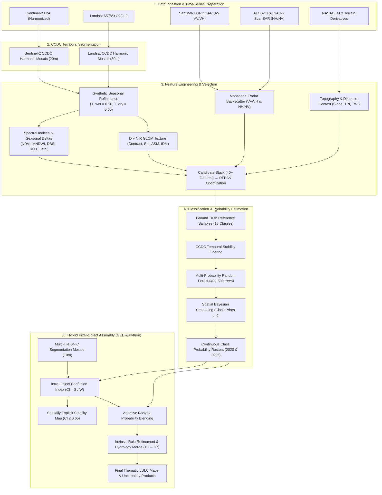

# Multi-Temporal Land Cover Classification & Hybrid Pixel–Object Assembly — Timor-Leste

[](https://earthengine.google.com/)
[](https://www.python.org/)
[](#license)

A reproducible, high-resolution remote sensing framework for multi-temporal land use/land cover (LULC) classification and change detection across Timor-Leste. The pipeline couples **Google Earth Engine (GEE)** cloud-based continuous time-series modeling with a **streaming windowed Python post-processing engine**, producing wall-to-wall LULC maps for **2020** and **2025** at 10 m (Sentinel-2) and 30 m (Landsat) resolution.

---

## Methodological Highlights

1. **CCDC Temporal Segmentation & Synthetic Phenological Reconstruction**:
   Continuous Change Detection and Classification (Zhu & Woodcock 2014) fits per-pixel harmonic trajectories across multi-year archives. Instead of simple cloud-masked medians, synthetic surface reflectance is evaluated at phenological extremes:
   - **Peak Wet Season ($T_{\text{wet}} = \text{Year} + 0.16$, ~mid-March):** Maximizes canopy photosynthetic vigor and surface water detection.
   - **Peak Dry Season ($T_{\text{dry}} = \text{Year} + 0.65$, ~late-August):** Accentuates deciduous canopy senescence, dry spectral contrast, and soil exposure.
   - **Mid-Year Harmonic Evaluation ($T_{\text{harm}} = \text{Year} + 0.50$):** Evaluates trend amplitudes and annual phases.

2. **Multi-Sensor Synergy & Phenological Deltas**:
   - **Optical:** Wet/dry synthetic bands (B2–B8A/B12), 8 seasonal spectral indices, and 6 wet-minus-dry phenological deltas ($\Delta_{\text{wet}-\text{dry}}$).
   - **Texture:** Dry-season NIR Gray-Level Co-occurrence Matrix (GLCM) metrics (contrast, entropy, ASM, IDM).
   - **Radar (SAR):** Seasonal dual-polarized Sentinel-1 GRD medians (VV/VH) and ALOS-2 PALSAR-2 ScanSAR medians (HH/HV gamma-nought dB).
   - **Topography & Ancillary:** NASADEM elevation, slope, aspect, Topographic Position Index (TPI landform), Topographic Wetness Index (TWI), and anthropogenic distance layers.

3. **Multi-Probability Random Forest with Stability Filtering**:
   - Sample purity is enforced by filtering out training samples within disturbance proximity ($\Delta t_{\text{break}}$) of CCDC segment breaks.
   - Random Forest runs in `MULTIPROBABILITY` mode (400–500 trees) to output complete 18-class posterior probability distributions $P(c \mid \mathbf{x})$.

4. **Hybrid Pixel–Object–Rule Classification with Stability Maps** *(Malinverni & Sanità 2026)*:
   Bridges pixel-level spectral nuance and superpixel spatial coherence via:
   - **Simple Non-Iterative Clustering (SNIC)** superpixels (10 m).
   - **Intra-Object Stability Map & Confusion Index ($CI = S / W$):** Quantifies decision competition between winning ($W$) and runner-up ($S$) probabilities. Parcels with $CI \le 0.65$ are marked stable.
   - **Adaptive Convex Blending:** Object probability weights are dynamically damped by local confusion:
     $$P_{\text{hyb}} = w_{\text{eff}} \cdot P_{\text{obj}} + (1 - w_{\text{eff}}) \cdot P_{\text{pix}}, \quad \text{where } w_{\text{eff}} = w_{\text{base}} \cdot (1 - 0.60 \times CI_{\text{obj}})$$
   - **Spatial Bayesian Smoothing:** Prior smoothing weighted by class contiguity ($\beta_c$).
   - **Intrinsic Rule Refinement:** Resolves urban roof / dark asphalt confusion against dry riverbeds and water bodies (False Hydrology Suppression).

---

## Methodological Workflow



---

## Land Cover Classification Schema

The pipeline maps an 18-class hierarchical schema specifically tuned for Timor-Leste's tropical monsoonal landscape. In final cartography and post-refinement, Class 18 (*Dry riverbed*) is merged into Class 17 (*Waterbody*).

| ID | Class Name | Color Hex | Characteristic Spectral & Environmental Profile |
|:--:|---|:--:|---|
| **1** | Primary Forest | `#00441B` | High NIR, minimal seasonal delta, steep slope/high altitude, high VH backscatter |
| **2** | Secondary Forest | `#238B45` | Moderate-high NDVI, moderate seasonal phenological variation |
| **3** | Mangrove Forest | `#006D2C` | Tidal intertidal zone (<5 m elevation), low MNDWI, coastal buffer |
| **4** | Coastal Forest | `#66C2A4` | Sandy/saline coastal plain (<50 m elevation), littoral vegetation |
| **5** | Teak Plantation | `#8C6D31` | Distinct dry-season deciduous drop, medium VH backscatter |
| **6** | Eucalyptus Plantation | `#A6761D` | Sclerophyllous spectral trajectory, mid-to-high elevations |
| **7** | Coffee Agroforestry | `#7FC97F` | High elevation (>800 m), shade canopy tree cover, moderate slopes |
| **8** | Cocoa Agroforestry | `#66A061` | Low-to-mid elevation, humid alluvial valleys with high TWI |
| **9** | Coconut Agroforestry | `#41AB5D` | Coastal to lowland plains, characteristic open canopy radar/texture signature |
| **10** | Mixed Garden | `#A1D76A` | Proximal to settlements, high spatial and spectral heterogeneity |
| **11** | Paddy Field | `#C7E9B4` | Flat terrain (slope <3°), high wet-season MNDWI/water inundation |
| **12** | Other Cropland | `#FDD835` | High seasonal amplitude (intense green in wet season, bare in dry season) |
| **13** | Grassland | `#D9EF8B` | Pronounced dry-season senescence, high DBSI, open canopy |
| **14** | Shrubland | `#C2A878` | Low woody biomass intermediate between grassland and secondary forest |
| **15** | Cleared Land | `#D7D6D6` | High DBSI/BLFEI, minimal vegetation indices, proximity to infrastructure |
| **16** | Built-up | `#DB310D` | High MBI/BLFEI, high VV double-bounce radar backscatter, road proximity |
| **17** | Waterbody | `#0E8ACC` | High MNDWI, negative NDVI, very low radar backscatter |
| **18** | Dry Riverbed | `#9ECAE1` | High BLFEI/DBSI, linear braided drainage corridors (merged into 17 in final maps) |

---

## Comparative Sensor Pipelines

| Dimension | Landsat Pipeline (30 m) | Sentinel-2 Pipeline (10–20 m) |
|---|---|---|
| **Primary Sensors** | Landsat 5/7/8/9 Collection 2 Level-2 | Sentinel-2 L2A (Harmonized) + Sentinel-1 GRD + ALOS-2 PALSAR-2 |
| **Temporal Segmentation** | CCDC (2000–2025) via `ccdc_landsat.js` | CCDC (2020–2025) via `ccdc_sentinel2.js` + Global CCDC |
| **Methodological Focus** | Phenological spectral indices & seasonal deltas | Multi-sensor SAR/optical fusion + superpixel OBIA |
| **Resolution** | 30 m | 10 m (optical bands & SNIC), 20 m (SWIR/RedEdge/CCDC) |
| **Feature Selection** | 36 RFECV-optimized predictors | 38 multi-sensor predictors (optical, SAR, GLCM, topography) |
| **Post-Processing** | Spatial Bayesian smoothing + Argmax | Bayesian smoothing + Hybrid SNIC assembly + Stability mapping |

---

## Repository Structure

```
Temporal_segment_gee/
├── src/                                  # Reusable Earth Engine library modules
│   ├── ccdc/
│   │   ├── ccdc_landsat.js               # Landsat 8/9 CCDC fit & synthetic reconstruction
│   │   └── ccdc_sentinel2.js             # Sentinel-2 CCDC fit & seasonal stacks
│   └── classification/
│       ├── classify_model.js             # Random Forest classifiers (hard/soft/multiprobability)
│       ├── extract_split_data.js         # Stratified/random train-test sampling
│       ├── tune_model.js                 # Hyperparameter grid search
│       ├── Post-process.js               # Spatial Bayesian smoothing & MMU filters
│       └── mask.js                       # Ancillary water/built-up evidence masks
│
├── Sentinel-2/                           # Sentinel-2 pipeline scripts (GEE JavaScript)
│   ├── 0_test_ccdc_s2.js                 # Sanity check: CCDC execution on small AOI
│   ├── 1_temporal_segment_s2.js          # Full CCDC fitting across 5 spatial tiles
│   ├── 2_1_feature_engineering_s2_2020.js# 2020 synthetic features and spectral indices
│   ├── 2_time_series_feature_engineering.js# Dual-epoch feature assembly (2020 & 2025)
│   ├── 3_time_series_model_tuning.js     # Random Forest parameter grid search
│   ├── 4_1_SNIC_segmentations.js         # Multi-tile SNIC superpixel segmentation (10m)
│   ├── 4_timer_series_classification_assembly.js# Classification assembly & export
│   ├── 5_end-to-end_sentinel-2.js        # Integrated pipeline: features, RF, & probability export
│   ├── 6_hybrid_pixel_object_assembly.js # GEE hybrid blending & stability mapping
│   ├── 7_export_probabilities_and_segments.js# Export multi-band probabilities & segment IDs
│   ├── 8_test_topographic_settlement_constraints.js# Topographic & settlement constraint testing
│   ├── METHODOLOGY_1_TIME_SERIES_FEATURE_ENGINEERING.md# Detailed S2 feature engineering specs
│   └── METHODOLOGY_2_HYBRID_PIXEL_OBJECT_ASSEMBLY.md   # Mathematical hybrid assembly specs
│
├── Landsat/                              # Landsat pipeline scripts (GEE JavaScript)
│   ├── 0_test_landsat_ccdc.js            # Sanity check: Landsat CCDC on test area
│   ├── 1_stable_data_filtering.js        # Stability mask & training sample filtering
│   ├── 1_temporal_segment_landsat.js     # Landsat CCDC segmentation export
│   ├── 2_1_feature_engineering_landsat_2015-2005.js# Historical features (2005 & 2015)
│   ├── 2_feature_engineering_landsat_2025.js       # 2025 Landsat feature stack
│   ├── 3_Landsat_integrated_features_and_tuning.js # Integrated extraction & tuning
│   ├── 3_Landsat_time_series_model_tuning.js       # RF hyperparameter tuning
│   ├── 4_1_SNIC_segmentations_landsat.js # Landsat 30m SNIC segmentation
│   ├── 4_Landsat_classification_assembly.js        # Landsat classification assembly
│   └── 5_end-to-end_Landsat.js           # Integrated end-to-end Landsat pipeline
│
├── python/                               # Local streaming windowed assembly & GIS utilities
│   ├── hybrid_assembly.py                # Out-of-core hybrid assembly, CI calculation & stability map
│   ├── raster_mosaic_stack.py            # Multiband raster stacking and mosaic generator
│   └── object-pixel_assembly.ipynb       # Interactive workflow walkthrough notebook
│
├── docs/                                 # Technical documentation & AI developer guides
│   ├── CLASSIFICATION_WORKFLOW.md        # Comprehensive multi-sensor operational context
│   └── HYBRID_PIXEL_OBJECT_WORKFLOW.md   # Theoretical framework & mathematical formulation
│
├── SENTINEL2_CLASSIFICATION_WORKFLOW.md  # Step-by-step user guide for S2 end-to-end pipeline
├── .gitignore                            # Repository ignore rules
└── README.md                             # Repository documentation
```

---

## Step-by-Step Execution Guide

### Phase 1: Earth Engine Feature Engineering & Probability Inference
All `.js` scripts run directly in the [Google Earth Engine Code Editor](https://code.earthengine.google.com).

1. **CCDC Segmentation**:
   - Run `Sentinel-2/1_temporal_segment_s2.js` (or `Landsat/1_temporal_segment_landsat.js`) to fit CCDC harmonic models over the AOI. For large regions, exports are split into 5 sub-regional tiles to avoid memory limits.
2. **Feature Extraction & Random Forest Training**:
   - Run `Sentinel-2/5_end-to-end_sentinel-2.js`:
     - Builds synthetic wet/dry imagery and calculates spectral indices, GLCM texture, and SAR backscatter.
     - Performs stability filtering on training samples.
     - Fits a multi-probability Random Forest classifier (`numberOfTrees: 400`, `variablesPerSplit: 6`).
     - Applies spatial Bayesian smoothing.
     - Exports 18-band class probability images for **2020** and **2025** to GEE Assets or Google Drive.
3. **SNIC Superpixel Segmentation**:
   - Run `Sentinel-2/4_1_SNIC_segmentations.js` to generate 10 m superpixels using normalized optical bands (`Red`, `NIR`, `SWIR1`, `NDVI`). Unique segment IDs use a stride offset ($\Delta = 300,000,000$) per tile.
4. **Export for Python Post-Processing**:
   - Run `Sentinel-2/7_export_probabilities_and_segments.js` to export aligned GeoTIFFs of the 18 probability bands and segment ID grids.

### Phase 2: Python Hybrid Assembly & Cartography
Post-processing can be executed either directly in GEE (`Sentinel-2/6_hybrid_pixel_object_assembly.js`) or via the local Python engine (`python/hybrid_assembly.py`), which handles out-of-core streaming and signed 32-bit integer overflow.

1. **Install Python Dependencies**:
   ```bash
   pip install numpy rasterio scipy
   ```
2. **Run Hybrid Assembly**:
   ```python
   from python.hybrid_assembly import run_hybrid_pipeline

   run_hybrid_pipeline(
       prob_raster_path="path/to/TL_2025_probabilities_18bands.tif",
       snic_raster_path="path/to/TL_2025_snic_segments.tif",
       output_dir="output/2025/",
       block_size=2048,
       padding=64
   )
   ```
   **Deliverables produced**:
   - `LULC_thematic_map.tif`: Final discrete classified map (Classes 1–17).
   - `stability_map.tif`: Binary classification stability flag ($CI \le 0.65$).
   - `confusion_index.tif`: Continuous decision ambiguity raster ($0.0 \le CI \le 1.0$).

---

## Key Dependencies & GEE Asset References

| Module / Asset | Location / Identifier | Description |
|---|---|---|
| `ccdc_sentinel2` | `users/rg2icraf/Luma:ccdc_sentinel2` | Sentinel-2 CCDC fitting & seasonal synthetic reconstruction |
| `ccdc_landsat` | `users/rg2icraf/Luma:ccdc_landsat` | Landsat CCDC fitting & synthetic reconstruction |
| `classify_model` | `users/rg2icraf/Luma:classify_model` | Hard, soft, and multi-probability Random Forest wrappers |
| `extract_split_data` | `users/rg2icraf/Luma:extract_split_data` | Stratified train/validation sampling |
| `tune_model` | `users/rg2icraf/Luma:tune_model` | Hyperparameter grid search |
| `post_process` | `users/rg2icraf/Luma:post_process` | Bayesian smoothing, MMU filtering, argmax classification |
| `mask` | `users/rg2icraf/Luma:mask` | Ancillary evidence masks (water, built-up) |
| `spectral` | `users/dmlmont/spectral:spectral` | Standardized spectral index calculations |
| Study AOI | `projects/ee-rg2v2/assets/AOI_Timor_Leste_10km` | National boundary with 10 km marine buffer |
| Reference Data | `projects/ee-rg2/assets/Samples/New_Samples_TL_2025` | 18-class ground-truth training/validation points |

---

## Output Specifications

| Specification | Sentinel-2 Deliverables | Landsat Deliverables |
|---|---|---|
| **Coordinate Reference System** | `EPSG:32751` (UTM Zone 51S) | `EPSG:32751` (UTM Zone 51S) |
| **Spatial Resolution** | 10 m (Classification, Stability, CI) | 30 m |
| **Target Epochs** | 2020, 2025 | 2005, 2015, 2020, 2025 |
| **Data Format** | Cloud-Optimized GeoTIFF (COG) | Cloud-Optimized GeoTIFF (COG) |
| **Probability Bit Depth** | `Float32` (18 continuous probability bands) | `Float32` |
| **Classification Bit Depth** | `Byte` / `UInt8` (Classes 1–17) | `Byte` / `UInt8` |

---

## References

1. **Malinverni, E. S., & Sanità, C. (2026).** A hybrid pixel-object based approach with stability maps for land cover classification. *ISPRS International Journal of Geo-Information*, 15(4), 241.
2. **Zhu, Z., & Woodcock, C. E. (2014).** Continuous change detection and classification of land cover using all available Landsat data. *Remote Sensing of Environment*, 144, 152–171.
3. **Camara, G. et al. (2024).** Bayesian smoothing for land cover classification. *Land Use Change Analysis using Satellite Image Time Series* ([sits book](https://e-sensing.github.io/sitsbook/cl_smoothing.html)).
4. **Montero, D. et al. (2023).** A standardized catalogue of spectral indices to advance remote sensing applications. *Scientific Data*, 10, 197. [`spectral` library](https://github.com/davemlz/spectral).

---

## License

This project is licensed under the MIT License — see the [LICENSE](LICENSE) file for details.
