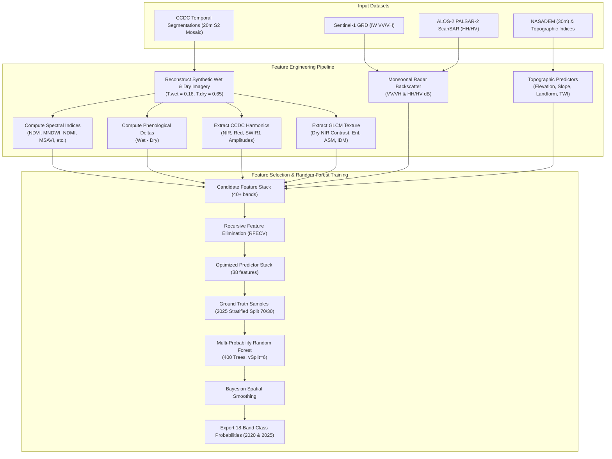

# Methodology Document 1: Time Series Segmentation & Feature Engineering

## 1. Overview & Objective
This document outlines the methodological framework and computational workflow for multi-temporal feature engineering and temporal segmentation applied to Sentinel-2 and auxiliary remote sensing data across Timor-Leste for epochs **2020** and **2025**.

The core implementation is encapsulated in [`5_end-to-end_sentinel-2.js`](file:///c:/Users/AFahrezi/Documents/GitHub/Temporal_segment_gee/Sentinel-2/5_end-to-end_sentinel-2.js).

The workflow addresses three persistent challenges in tropical landscape land cover mapping:
1. **Persistent Cloud Cover and Seasonal Variations:** Synthetic seasonal reconstruction via CCDC (Continuous Change Detection and Classification) eliminates cloud and shadow gaps. Additionally, CCDC provide consistent spectral pattern across different year which crucial for multi-temporal model transfer.
2. **Monsoonal Phenology:** Contrasting wet-season vs. dry-season spectral behavior separates deciduous forests, plantations, and annual croplands.
3. **Multi-Sensor Synergy:** Combining optical reflectance, phenological harmonic coefficients, radar backscatter (Sentinel-1 SAR and PALSAR-2 ScanSAR), and topographic indices into an optimized predictor stack.

---

## 2. High-Level Workflow Architecture



---

## 3. CCDC Temporal Segmentation & Synthetic Image Reconstruction

Instead of computing arbitrary temporal composites (such as cloud-masked median mosaics), this pipeline leverages **CCDC (Continuous Change Detection and Classification)** fits pre-calculated across Timor-Leste from Sentinel-2 time series:

$$\hat{\rho}_{i}(t) = a_{0,i} + c_{1,i} t + \sum_{k=1}^{3} \left[ a_{k,i} \cos\left(\frac{2\pi k t}{T}\right) + b_{k,i} \sin\left(\frac{2\pi k t}{T}\right) \right]$$

### Fractional Year Seasonal Reconstruction
To capture phenological extremes without cloud interference, synthetic surface reflectance is reconstructed at specific annual phase fractions:
- **Peak Wet Season ($T_{\text{wet}} = 0.16$ / mid-March):** Maximizes canopy photosynthetic vigor and surface water detection.
- **Peak Dry Season ($T_{\text{dry}} = 0.65$ / late-August):** Accentuates senescent vegetation, bare soil exposure, and deciduous canopy drop.
- **Mid-Year Harmonic Evaluation ($T_{\text{harm}} = 0.50$):** Used to evaluate segment trend lines and amplitudes.

Synthetic stacks are generated for six reflective bands: Blue (B2), Green (B3), Red (B4), NIR (B8), SWIR1 (B11), and SWIR2 (B12).

---

## 4. Multi-Sensor Feature Engineering

### 4.1 Spectral Indices & Seasonal Phenological Deltas
From the reconstructed seasonal synthetic imagery, 8 primary spectral indices are derived via Google Earth Engine's `spectral` library:
- **Vegetation:** `NDVI`, `GBNDVI`, `MSAVI`
- **Moisture & Canopy Water:** `NDMI`
- **Surface Water & Wetlands:** `MNDWI`
- **Built-up & Bare Soil:** `BLFEI`, `DBSI`, `MBI`

**Seasonal Deltas:** To capture dynamic agricultural cycles and deciduous phenology, differential indices are calculated:
$$\Delta \text{Index} = \text{Index}_{\text{wet}} - \text{Index}_{\text{dry}}$$
(Computed for: `BLFEI`, `DBSI`, `MBI`, `MNDWI`, `MSAVI`, and `NDMI`).

### 4.2 CCDC Intra-Annual Harmonics
Harmonic amplitude features are extracted for `nir`, `red`, and `swir1` (`red_amp`, `swir1_amp`). High amplitudes signify cyclical changes (e.g., agricultural planting/fallow cycles, seasonal savannahs), whereas low amplitudes indicate stable perennial land cover (e.g., primary rainforest, waterbodies).

### 4.3 Spatial Texture (GLCM)
To distinguish homogenous plantations (e.g., teak, coconut) from structurally complex natural forests, Gray-Level Co-occurrence Matrix (GLCM) textures are calculated on dry-season NIR (`B8`) at 1-pixel kernel radius:
- Contrast (`B8_contrast`)
- Entropy (`B8_ent`)
- Angular Second Moment (`B8_asm`)
- Inverse Difference Moment (`B8_idm`)

### 4.4 Multi-Frequency SAR Backscatter
- **Sentinel-1 C-band SAR:** Dual-polarization (VV, VH) Interferometric Wide (IW) imagery is aggregated into seasonal medians:
  - Wet season: December to April
  - Dry season: May to November
  - Provides volume scattering (VH) and double-bounce/roughness (VV) sensitive to crop canopy structure and flooding.
- **ALOS-2 PALSAR-2 L-band ScanSAR:** 
  - Annual median HH and HV backscatter converted to $\gamma^0$ in decibels:
    $$\gamma^0 (\text{dB}) = 10 \cdot \log_{10}(\text{DN}^2) - 83.0$$
  - The longer 24 cm L-band wavelength penetrates forest canopies, separating dense woody biomass from secondary regrowth and shrubland.

### 4.5 Topography & Geomorphology
- **NASADEM (30m):** Elevation and derived slope/aspect products.
- **Topographic Position Index (TPI) Landform Classification:** Distinguishes ridges, upper slopes, flat plains, and valley bottoms.
- **Topographic Wetness Index (TWI):** Models steady-state hydrological accumulation to isolate riparian corridors and floodable lowlands.

---

## 5. Feature Selection & Random Forest Training

### 5.1 Optimal Predictor Stack (38 Features)
The initial feature stack is optimize using Recursive Feature Elimination with Cross-Validation (RFECV). The RFECV workflow is conducting by extracting the pixel value based on the training data into CSV table. The RFECV is computed using Google Collaboratory or standard python environment. Code Snippets for the RFECV is shown below:
```python
#Initialize base Random Forest estimator
from sklearn.ensemble import RandomForestClassifier
from sklearn.feature_selection import RFECV
from sklearn.model_selection import StratifiedKFold
rf = RandomForestClassifier(
    n_estimators=100,
    random_state=42,
    n_jobs=-1)

# Set up RFECV using Stratified 5-Fold Cross-Validation
rfecv = RFECV(estimator=rf,step=1,                          
    cv=StratifiedKFold(7, shuffle=True, random_state=42),          
    scoring='f1_macro',              
    min_features_to_select=15,       
    n_jobs=-1
)

# Fit RFECV on training samples
print("Running RFECV feature selection...")
rfecv.fit(X, y)

print(f"\nOptimal number of features selected: {rfecv.n_features_}")
```
The RFECV identify 38 layers as the optimal subset balancing computational efficiency and classification accuracy:

| Category | Features |
| :--- | :--- |
| **Wet Season Reflectance** | `B2_wet`, `B3_wet`, `B4_wet`, `B8_wet`, `B11_wet`, `B12_wet` |
| **Dry Season Reflectance** | `B2_dry`, `B3_dry`, `B4_dry`, `B8_dry`, `B11_dry`, `B12_dry` |
| **Spectral Indices (Dry/Wet)** | `BLFEI_dry`, `BLFEI_wet`, `DBSI_dry`, `GBNDVI_dry`, `GBNDVI_wet`, `MBI_dry`, `MBI_wet`, `MNDWI_dry`, `MNDWI_wet`, `MSAVI_wet`, `NDMI_dry`, `NDVI_dry`, `NDVI_wet` |
| **Phenological Deltas** | `MBI_delta`, `NDMI_delta` |
| **CCDC Harmonics** | `red_amp`, `swir1_amp` |
| **Radar Backscatter** | `VV_wet`, `VV_dry`, `VH_wet`, `VH_dry`, `ScanSAR_HH_dB`, `ScanSAR_HV_dB` |
| **Topography** | `elevation`, `slope`, `TWI` |

### 5.2 Multi-Probability Random Forest Classification
- **Ground Truth Sampling:** 2025 reference sample points (`new_id`, 18 target classes) partitioned using stratified random splitting: 70% training, 30% holdout testing (seed 42).
- **Hyperparameter Configuration:**
  - Trees: `400`
  - Variables per split (`vSplit`): `6`
  - Minimum leaf population: `1`
- **Output Representation:** Rather than predicting hard discrete labels, the classifier outputs the posterior probability distribution vector across all 18 classes:
  $$\mathbf{P}(x) = [P_1(x), P_2(x), \dots, P_{18}(x)], \quad \sum_{c=1}^{18} P_c(x) = 1.0$$
  This probabilistic representation serves as the primary input for Bayesian spatial smoothing and hybrid object assembly.

---

## 6. Multi-Year Inference & Output Assets
The identical trained classifier is applied to both the **2025** and **2020** optimized predictor stacks:
1. `TL_S2_class_probabilities_2025` (Earth Engine Asset, 20m, EPSG:32751)
2. `TL_S2_class_probabilities_2020` (Earth Engine Asset, 20m, EPSG:32751)
Each asset contains 18 continuous float bands (scaled $\times 10,000$ for integer storage).
