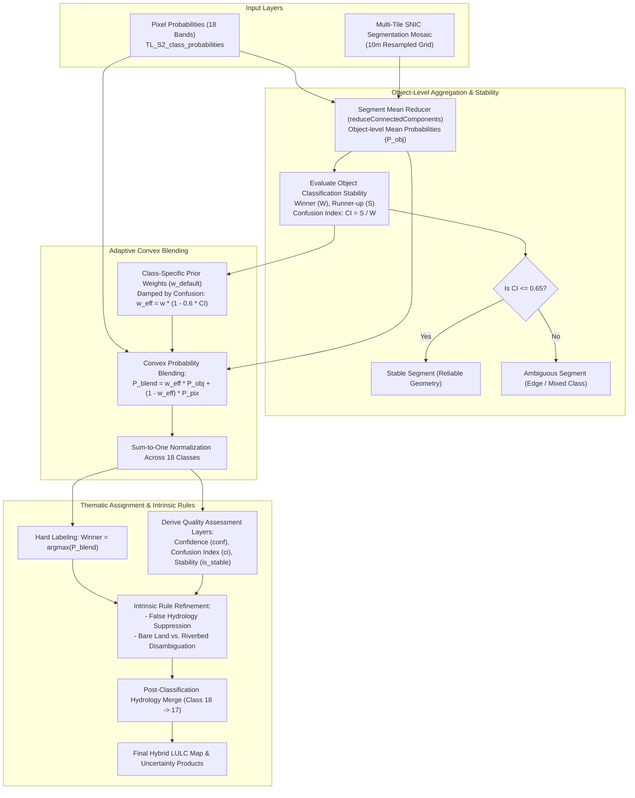

# Methodology Document 2: Hybrid Pixel-Object Based Assembly

## 1. Overview & Objective
This document outlines the methodological framework and computational workflow for the **Hybrid Pixel-Object Based Classification** pipeline developed for Timor-Leste national land cover mapping.

The core implementation is encapsulated in [`6_hybrid_pixel_object_assembly.js`](file:///c:/Users/AFahrezi/Documents/GitHub/Temporal_segment_gee/Sentinel-2/6_hybrid_pixel_object_assembly.js), which operationalizes concepts from modern Object-Based Image Analysis (OBIA) and the multi-criteria spatial reliability framework of **Malinverni & Sanità (2026)**.

The hybrid architecture resolves a fundamental trade-off in remote sensing:
- **Pixel-Based Classifiers:** Retain subtle intra-patch spectral variations and narrow linear features (e.g., roads, riparian corridors), but suffer from high-frequency "salt-and-pepper" classification noise.
- **Pure Object-Based (OBIA) Classifiers:** Produce clean, parcel-like homogeneous polygons, but can over-generalize, miss small isolated settlements, or incorrectly merge mixed boundaries into majority classes.
- **The Hybrid Solution:** Convex probabilistic blending of pixel-level and segment-level posterior distributions, adaptively modulated by local classification confidence and confusion metrics.

---

## 2. High-Level Workflow Architecture

---

## 3. Superpixel Segmentation via SNIC

To establish spatial object units without relying on expensive polygon vectorization, the pipeline uses **Simple Non-Iterative Clustering (SNIC)**:
- Generated at **10m resolution** from multi-band optical Sentinel-2 composites.
- Segment boundaries adhere tightly to natural terrain boundaries, field edges, forest margins, and water courses.
- **Multi-Tile Mosaic Strategy:** To manage Earth Engine memory limits, SNIC is exported across 5 spatial sub-regions (`seg_central_timor`, `seg_east_box`, `seg_off_dili`, `seg_west_box`, `seg_east_timor`). An ID offset stride ($\Delta = 300,000,000$) is added to each tile before mosaicking to guarantee globally unique segment IDs while staying safely below the signed 32-bit integer ceiling ($2,147,483,647$).

---

## 4. Probabilistic Object Aggregation & Stability Assessment

### 4.1 Segment-Level Probability Vectors
For every contiguous superpixel $S_k$, the mean posterior probability for each of the 18 classes is computed via `reduceConnectedComponents`:
$$\bar{P}_c(S_k) = \frac{1}{|S_k|} \sum_{x \in S_k} P_c(x), \quad c \in \{1, 2, \dots, 18\}$$

### 4.2 Stability Map & Confusion Index (Malinverni & Sanità 2026)
To prevent inhomogeneous segments from imposing incorrect classifications on distinct sub-pixel features, each segment's internal decision ambiguity is quantified:
1. **Winning Probability ($W$):**
   $$W(x) = \max_{c \in \{1, \dots, 18\}} \bar{P}_c(x)$$
2. **Runner-up Probability ($S$):** The second-highest probability in the distribution vector:
   $$S(x) = \max_{c \neq \text{argmax}(\bar{P})} \bar{P}_c(x)$$
3. **Confusion Index ($CI$):** Ratio measuring decision competition:
   $$CI(x) = \frac{S(x)}{W(x)}, \quad 0 \le CI \le 1.0$$
   - $CI \approx 0$: Absolute certainty; the winner dominates overwhelmingly.
   - $CI \to 1.0$: High confusion; the classifier cannot decisively separate the top two classes.
4. **Binary Stability Map ($I_{\text{stable}}$):**
   $$I_{\text{stable}}(x) = \begin{cases} 1 & \text{if } CI(x) \le \tau \quad (\tau = 0.65) \\ 0 & \text{if } CI(x) > \tau \end{cases}$$

---

## 5. Adaptive Convex Blending Formulation

Rather than a static global weight, blending between pixel evidence and object context is dynamic and class-aware:

$$P_{\text{blend}, c}(x) = w_{\text{eff}, c}(x) \cdot \bar{P}_c(S_k) + \big(1 - w_{\text{eff}, c}(x)\big) \cdot P_c(x)$$

### 5.1 Base Class Trust Weights ($w_c$)
Classes with large contiguous patches (e.g., Primary Forest, Waterbodies) receive high object trust, whereas fine-grained, fragmented classes (e.g., Built-up, Croplands, Dry riverbeds) give higher weight to pixel evidence:

| Class Name | ID | Bayesian Smoothness | Base Object Weight ($w_c$) |
| :--- | :---: | :---: | :---: |
| **Primary Forest** | 1 | 4.5 | 0.90 |
| **Secondary Forest** | 2 | 3.0 | 0.60 |
| **Mangrove Forest** | 3 | 3.0 | 0.60 |
| **Coastal Forest** | 4 | 3.5 | 0.70 |
| **Plantations (Teak / Eucalyptus)** | 5, 6 | 1.2 | 0.24 |
| **Agroforestry / Mixed Garden** | 7, 8, 9, 10 | 1.2 – 1.5 | 0.24 – 0.30 |
| **Cropland / Paddy Field** | 11, 12 | 1.0 | 0.20 |
| **Grassland / Shrubland / Cleared Land** | 13, 14, 15 | 1.5 | 0.30 |
| **Built-up / Settlement** | 16 | 1.0 | 0.20 |
| **Waterbody** | 17 | 4.0 | 0.80 |
| **Dry Riverbed** | 18 | 0.1 | 0.20 |

### 5.2 Adaptive Confusion Damping
When a segment falls into high spectral confusion ($CI > 0.65$), relying heavily on the segment average risks propagating an erroneous majority label across real minority features. The effective object weight is dynamically decayed:

$$w_{\text{eff}, c}(x) = w_c \cdot \big[ 1.0 - \alpha \cdot CI(x) \big], \quad \alpha = 0.6$$

Under high confusion, $w_{\text{eff}}$ automatically down-weights the segment contribution, allowing reliable local pixel probabilities to retain spatial detail.

---

## 6. Intrinsic Rule-Based Refinement

Spectrally overlapping classes in complex island topographies frequently exhibit high pair-wise confusion:
- **Urban roofs & asphalt vs. Dry riverbed / Bare land:** Corrugated metal roofs and coastal sand deposits mimic dry gravel riverbed reflectance.
- **Topographic shadow vs. Water:** Deep mountain gullies occasionally trigger low reflectance water probabilities.

The script applies targeted disambiguation rules based on the Winner ($W$), Runner-up ($S$), and $CI$:

1. **False Hydrology Suppression:**
   If the winning label is Waterbody (17) or Dry Riverbed (18), but the runner-up is Built-up (16) or Cleared Land (15) with high decision ambiguity ($CI > 0.65$), the pixel is reallocated to the terrestrial runner-up class.
2. **Cleared Land vs. Dry Riverbed Disambiguation:**
   If Dry Riverbed (18) wins over Cleared Land (15) with $CI > 0.75$ in upland terrestrial contexts, Cleared Land is retained.
3. **Hydrological Aggregation:**
   To align with reporting standards while preserving dry-season spectral separability during classification, Dry Riverbed (18) is merged into Waterbody (17) as the final post-classification step (`lulc.where(lulc.eq(18), 17)`).

---

## 7. Multi-Layer Uncertainty & Quality Output Products

The hybrid assembly script generates five co-registered information layers:
1. `lulc_refined`: Final thematic land-cover class (values 1–18, uint8).
2. `conf`: Classification Confidence of the winning class ($W \times 100$, 0–100%, uint8).
3. `ci`: Confusion Index ($CI \times 100$, 0–100%, uint8), flagging boundary transitions and spectral overlap.
4. `runner_up`: Secondary competing class ID, providing auditability for mixed pixels.
5. `is_stable`: Binary spatial reliability mask (1 = Stable, 0 = Ambiguous).
