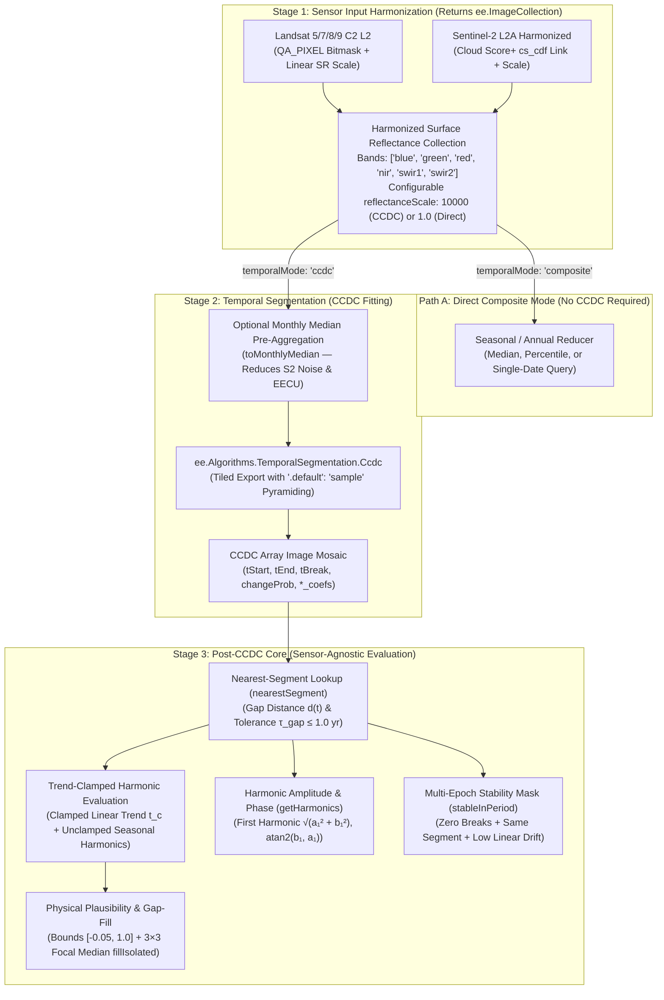

# CCDC Temporal Segmentation & Synthetic Reconstruction Architecture

## 1. Overview & Scientific Rationale

Persistent cloud cover, monsoon-driven phenological swings, and sensor transitions (Landsat 5/7/8/9 and Sentinel-2A/B/C) make direct image compositing unreliable for multi-epoch land use/land cover (LULC) mapping in wet-dry tropical environments. Simple seasonal median composites often blend observations from different phenological stages, retain residual haze or cloud shadows, and suffer from data gaps during peak wet seasons.

To overcome these limitations, this pipeline uses **Continuous Change Detection and Classification (CCDC)** (Zhu & Woodcock, 2014) to fit per-pixel harmonic time-series models across multi-year satellite archives. The fitted harmonic trajectories serve three distinct roles in the workflow:

1. **Cloud-Free Seasonal Synthetic Reconstruction**: Reconstructs surface reflectance at exact fractional-year dates corresponding to peak wet season ($T_{\text{wet}} = \text{Year} + 0.16$, ~mid-March) and peak dry season ($T_{\text{dry}} = \text{Year} + 0.65$, ~late-August), ensuring radiometric and phenological consistency across epochs.
2. **Phenological descriptors (Harmonic Amplitude & Phase)**: Extracts intra-annual periodic metrics ($\text{Amplitude}$ and $\text{Phase}$ of the annual cycle) directly from model coefficients to separate evergreen, deciduous, and annual agricultural land covers.
3. **Multi-Epoch Training Sample Stability Filtering**: Identifies abrupt land cover breaks (`tBreak`) and gradual spectral drift ($c_1$ slope) so reference samples collected in a baseline year (e.g., 2025) can be safely transferred to historical epochs (2020, 2015, 2005) only where the landscape remained stable.

---

## 2. Stage-Based Modular Architecture

Rather than splitting code into monolithic sensor-specific vertical silos (`ccdc_landsat.js` vs. `ccdc_sentinel2.js`), the CCDC subsystem is architected **by processing stage**. Sensor differences (band numbering, QA bitmasks, Cloud Score+ linking, scaling constants) exist strictly at the data ingestion boundary. Once harmonized into a common 6-band spectral schema (`['blue', 'green', 'red', 'nir', 'swir1', 'swir2']`), all downstream temporal segmentation, synthetic evaluation, and harmonic extraction share a single mathematical core.

### Dual-Mode Flexibility: CCDC vs. Direct Image Collection Queries
Because **Stage 1** returns a clean, cloud-masked, and band-harmonized `ee.ImageCollection`, the input modules can be used **independently of CCDC**:
- **`temporalMode: 'ccdc'`**: Feeds the collection (scaled to $0\text{–}10000$) into CCDC temporal segmentation for multi-year harmonic modeling.
- **`temporalMode: 'composite'`**: Returns the collection (scaled to $0\text{–}1$ reflectance) for direct date/region queries, seasonal median/percentile reductions, or rapid single-year classification where multi-temporal segmentation is unnecessary. Both paths emit identical band names (`['blue', 'green', 'red', 'nir', 'swir1', 'swir2']`), allowing [`src/features.js`](file:///c:/Users/AFahrezi/Documents/GitHub/Temporal_segment_gee/src/features.js) to compute spectral indices, phenological deltas, and GLCM textures without modification.

---

## 3. Stage 1: Sensor Input Harmonization

### 3.1. Common Spectral Schema

All optical sensors are mapped to a six-band lowercase schema before leaving the input stage:

| Standard Band Name | Wavelength Domain | Landsat 5/7 (TM/ETM+) | Landsat 8/9 (OLI/OLI-2) | Sentinel-2 (MSI L2A) | Native Resolution (L / S2) |
|---|---|---|---|---|---|
| `blue` | Blue ($\sim 0.48\,\mu\text{m}$) | `SR_B1` | `SR_B2` | `B2` | $30\text{ m}$ / $10\text{ m}$ |
| `green` | Green ($\sim 0.56\,\mu\text{m}$) | `SR_B2` | `SR_B3` | `B3` | $30\text{ m}$ / $10\text{ m}$ |
| `red` | Red ($\sim 0.66\,\mu\text{m}$) | `SR_B3` | `SR_B4` | `B4` | $30\text{ m}$ / $10\text{ m}$ |
| `nir` | Near-Infrared ($\sim 0.85\,\mu\text{m}$) | `SR_B4` | `SR_B5` | `B8` | $30\text{ m}$ / $10\text{ m}$ |
| `swir1` | Shortwave IR 1 ($\sim 1.61\,\mu\text{m}$) | `SR_B5` | `SR_B6` | `B11` | $30\text{ m}$ / $20\text{ m}$ |
| `swir2` | Shortwave IR 2 ($\sim 2.20\,\mu\text{m}$) | `SR_B7` | `SR_B7` | `B12` | $30\text{ m}$ / $20\text{ m}$ |

### 3.2. Cloud Masking & Radiometric Scaling

1. **Landsat Collection 2 Level-2 (`LANDSAT/LT05|LE07|LC08|LC09/C02/T1_L2`)**:
   - **Masking**: Evaluates `QA_PIXEL` bitwise flags to reject Fill (`bit 0`, critical for Landsat 7 SLC-off scanline gaps), Dilated Cloud (`bit 1`), Cloud (`bit 3`), Cloud Shadow (`bit 4`), and Snow (`bit 5`).
   - **Scaling**: Applies the USGS Collection 2 surface reflectance linear transformation and scales by `reflectanceScale` ($S_{\text{ref}} = 10000$ for CCDC, $1.0$ for direct reflectance):
     $$\rho_{\text{scaled}} = \left(0.0000275 \times \text{DN} - 0.2\right) \times S_{\text{ref}}$$

2. **Sentinel-2 SR Harmonized (`COPERNICUS/S2_SR_HARMONIZED`)**:
   - **Masking**: Dynamically links each acquisition to `GOOGLE/CLOUD_SCORE_PLUS/V1/S2_HARMONIZED` and masks pixels where the cumulative distribution quality score `cs_cdf` falls below `clearThreshold` ($0.50\text{–}0.60$).
   - **Scaling**: Native S2 L2A values are stored as integers in $[0, 10000]$. The input stage multiplies by $S_{\text{ref}} / 10000$ (retaining $0\text{–}10000$ when $S_{\text{ref}} = 10000$ for CCDC, or dividing by $10000$ when $S_{\text{ref}} = 1.0$ for direct composites).

> [!IMPORTANT]
> **Why CCDC Requires $0\text{–}10000$ Input Scaling:**
> Earth Engine's `ee.Algorithms.TemporalSegmentation.Ccdc` uses a default LASSO regularization penalty (`lambda = 20`) calibrated for surface reflectance scaled to $[0, 10000]$. Feeding $0\text{–}1$ float reflectance directly into CCDC with `lambda = 20` over-penalizes harmonic terms and flattens seasonal curves to zero unless `lambda` is rescaled by $10^{-4}$. Keeping `reflectanceScale = 10000` for CCDC runs and dividing coefficients by `coefScale = 10000` during synthetic reconstruction preserves standard CCDC hyperparameter behavior.

---

## 4. Stage 2: CCDC Fitting & Export Strategy

### 4.1. Monthly Median Pre-Compositing (`toMonthlyMedian`)
For dense Sentinel-2 time series (5-day revisit) or multi-sensor Landsat archives, `toMonthlyMedian(col, startDate, endDate)` aggregates clear observations into monthly median composites timestamped at the 15th of each month (dropping empty months where `n == 0`). This step:
- Suppresses residual unmasked cloud fringes and ephemeral atmospheric noise that would otherwise trigger false CCDC breakpoints.
- Stabilizes observation density between wet and dry seasons.
- Reduces Earth Engine Compute Unit (EECU) consumption and memory pressure during full-country CCDC exports.

### 4.2. Harmonic Regression Formulation
For each pixel and spectral band $i$, CCDC segments the time series at detected breakpoints and fits an 8-parameter ordinary least squares / LASSO harmonic regression model within each stable segment $[t_{\text{start}}, t_{\text{end}}]$:

$$\hat{\rho}_{i}(t) = \underbrace{a_{0,i} + c_{1,i} t}_{\text{Intercept & Linear Trend}} + \underbrace{\sum_{k=1}^{3} \left[ a_{k,i} \cos(k\omega t) + b_{k,i} \sin(k\omega t) \right]}_{\text{1st, 2nd, and 3rd Order Intra-Annual Harmonics}}$$

where:
- $t$ is time in fractional years (`dateFormat: 1`, e.g., $2025.65$),
- $\omega = 2\pi$ is the annual angular frequency,
- $a_{0,i}$ is the overall intercept and $c_{1,i}$ is the inter-annual linear slope (capturing gradual growth, succession, or degradation),
- $(a_{k,i}, b_{k,i})$ for $k \in \{1, 2, 3\}$ are the harmonic cosine and sine coefficients Stored in `*_coefs` as an 8-element vector:
  $$\mathbf{c}_i = \left[\, a_{0,i},\; c_{1,i},\; a_{1,i},\; b_{1,i},\; a_{2,i},\; b_{2,i},\; a_{3,i},\; b_{3,i} \,\right]$$

### 4.3. CCDC Hyperparameters & Tiled Export Configuration

| Parameter | Value | Description |
|---|---|---|
| `breakpointBands` | `['green', 'red', 'nir', 'swir1', 'swir2']` (or subset) | Bands evaluated for change detection |
| `tmaskBands` | `['green', 'swir1']` (Landsat) | Multitemporal cloud/shadow outlier rejection during model initialization |
| `dateFormat` | `1` | Fractional years (e.g., `2025.16`) |
| `minObservations` | `6` | Consecutive outlier observations required to confirm a breakpoint |
| `chiSquareProbability` | `0.99` | Chi-square change threshold (higher = stricter breakpoint confirmation) |
| `minNumOfYearsScaler` | `1.33` | Minimum window length factor for initializing a harmonic fit |
| `lambda` | `20` | LASSO penalty parameter (calibrated for $0\text{–}10000$ reflectance units) |
| `maxIterations` | `25000` | Maximum LASSO coordinate descent iterations |

To stay within GEE compute limits across national extents, exports are partitioned into 5 sub-regional tiles (`west_box`, `central_timor`, `off_dili`, `east_box`, `east_timor`), retaining only the bands required downstream (`['tStart', 'tEnd', 'tBreak', 'changeProb', '.*_coefs']`) and using **`pyramidingPolicy: {'.default': 'sample'}`** (mandatory for array-valued GEE images).

---

## 5. Stage 3: Post-CCDC Reconstruction & Methodological Safeguards

While external libraries such as `gee-ccdc-tools` (`users/parevalo_bu/gee-ccdc-tools:ccdcUtilities/api`) provide general CCDC utilities, our post-CCDC core implements four specific methodological safeguards tailored for multi-epoch classification in cloud-prone tropics.

### 5.1. Nearest-Segment Lookup with Gap Tolerance (`nearestSegment`)
Standard CCDC evaluation fails (returns masked/nodata pixels) whenever the target fractional date $t$ falls inside a fitting gap between two segments ($t_{\text{end}, s} < t < t_{\text{start}, s+1}$) or slightly outside the first/last fitted segment due to persistent cloud cover at the archive boundaries.

Instead of dropping those pixels, `nearestSegment(ccdc, t)` computes the temporal distance $d(t, s)$ from $t$ to every segment $s$:

$$d(t, s) = \max\Big(0,\; t_{\text{start}, s} - t,\; t - t_{\text{end}, s}\Big)$$

- If $t \in [t_{\text{start}, s}, t_{\text{end}, s}]$, the distance is $d(t, s) = 0$.
- If $t$ lies outside all segments, `nearestSegment` selects the segment index $s^* = \arg\min_s d(t, s)$ and records the temporal gap $\text{gap\_years} = d(t, s^*)$.
- Any pixel with $\text{gap\_years} \le \tau_{\text{gap}}$ (default $\tau_{\text{gap}} = 1.0\text{ year}$) is reconstructed from segment $s^*$; pixels exceeding $\tau_{\text{gap}}$ are masked as unreliable.

### 5.2. Linear Trend Clamping ($t_c$)
When reconstructing a pixel from a nearby segment ($d(t, s^*) > 0$), evaluating the linear trend term $a_{0,i} + c_{1,i} t$ at an extrapolated date $t$ outside $[t_{\text{start}, s^*}, t_{\text{end}, s^*}]$ can cause steep transitional slopes ($c_{1,i}$) to overshoot into unphysical reflectance values.

To prevent linear trend overshoot while preserving exact seasonal phenology, the evaluation separates the time variable into two components:
1. **Clamped Trend Time ($t_c$)** — restricted strictly to the active segment bounds:
   $$t_c = \min\Big(\max\big(t,\; t_{\text{start}, s^*}\big),\; t_{\text{end}, s^*}\Big)$$
2. **Unclamped Harmonic Time ($t$)** — evaluated at the requested seasonal phase ($T_{\text{wet}} = 0.16$ or $T_{\text{dry}} = 0.65$):
   $$\hat{\rho}_{i}(t) = \frac{1}{\text{coefScale}} \left( a_{0,i} + c_{1,i} t_c + \sum_{k=1}^{3} \left[ a_{k,i} \cos(k\omega t) + b_{k,i} \sin(k\omega t) \right] \right)$$

### 5.3. Unified Physical Plausibility Bounds & Isolated Hole Filling
Even within active segments, noisy harmonic fits in steep terrain shadows or coastal waters can occasionally oscillate outside physically valid surface reflectance ranges.

1. **Unified Physical Bounds (`REFLECTANCE_BOUNDS: { min: -0.05, max: 1.0 }`)**:
   - Lower bound ($-0.05$): Leniently accommodates dark waterbodies and topographic shadows where atmospheric over-correction produces slightly negative SWIR/Red reflectance.
   - Upper bound ($1.0$): Enforces the physical ceiling of diffuse surface reflectance across both Landsat and Sentinel-2 (eliminating harmonic overshoot artifacts).
   - **All-Band Validity**: A pixel is marked valid (`synth_valid = 1`) only if $\text{gap\_years} \le \tau_{\text{gap}}$ **and** every reconstructed band satisfies $-0.05 < \hat{\rho}_i(t) < 1.0$. Masking all bands together guarantees that spectral indices computed downstream never mix valid and invalid bands at the same pixel.

2. **Conditional $3\times 3$ Focal Median Repair (`fillIsolated`)**:
   - Isolated single-pixel or two-pixel dropouts masked by the plausibility check are filled using a $3\times 3$ focal median (`ee.Kernel.square(1)`), **only where at least 5 of the 8 surrounding neighbors are valid** (`minNeighbors = 5`). Larger contiguous gaps remain masked rather than hallucinated.

### 5.4. First-Harmonic Amplitude & Phase (`getHarmonics`)
For the active/nearest segment $s^*$, the first-order annual harmonic coefficients $(a_{1,i}, b_{1,i})$ (scaled by $\text{coefScale}$) are transformed into polar phenological metrics:

$$\text{Amplitude}_i = \sqrt{a_{1,i}^2 + b_{1,i}^2}, \qquad \text{Phase}_i = \text{atan2}(b_{1,i},\; a_{1,i}) \in [-\pi, \pi]$$

- **$\text{Amplitude}_i$** quantifies the magnitude of annual seasonal variation (high in deciduous teak plantations, paddy fields, and seasonal grasslands; low in evergreen primary forests and waterbodies).
- **$\text{Phase}_i$** captures the timing of peak greenness/moisture within the annual cycle.

---

## 6. Multi-Epoch Sample Stability Filtering (`stableInPeriod`)

When mapping historical epochs (e.g., 2005, 2015, 2020) using reference training samples collected in 2025, samples located on pixels that changed land cover between the historical target year and 2025 must be excluded.

The stability filter evaluates three conditions over any interval $[t_{\text{start}}, t_{\text{end}}]$:

1. **Zero Confirmed Breakpoints**:
   No segment break with `changeProb == 1` occurred inside the interval:
   $$\forall s,\quad \text{changeProb}_s = 1 \implies t_{\text{break}, s} \notin [t_{\text{start}}, t_{\text{end}}]$$
2. **Continuous Single-Segment Coverage**:
   Both the historical evaluation date ($t_{\text{start}} + 0.50$) and the baseline date ($\lfloor t_{\text{end}} \rfloor + 0.50$) fall within gap tolerance $\tau_{\text{gap}}$ **and** map to the exact same CCDC segment index:
   $$\text{gap}(t_{\text{start}}) \le \tau_{\text{gap}} \;\land\; \text{gap}(t_{\text{end}}) \le \tau_{\text{gap}} \;\land\; s^*(t_{\text{start}}) = s^*(t_{\text{end}})$$
3. **Gradual Linear Drift Constraint**:
   Even without a discrete breakpoint, slow forest degradation, regrowth, or gradual encroachment can alter a pixel's class over 10–20 years. The cumulative reflectance drift in NIR and SWIR1 across $\Delta t = t_{\text{end}} - t_{\text{start}}$ must remain below $\Delta\rho_{\max} = 0.12$:
   $$\left|\frac{c_{1,\text{nir}}}{\text{coefScale}} \cdot \Delta t\right| \le 0.12 \quad \land \quad \left|\frac{c_{1,\text{swir1}}}{\text{coefScale}} \cdot \Delta t\right| \le 0.12$$

For polygon training samples, `ee.Reducer.min()` is applied over `stable_{year}` so that a polygon is retained only if **every constituent pixel** inside the polygon remained stable throughout the period.

---

## 7. Asset Metadata & Backward Compatibility Profile

To ensure the unified post-CCDC core works seamlessly across existing Timor-Leste CCDC assets, Google's global pre-computed CCDC archive, and newly generated runs for other regions, CCDC asset descriptors in [`src/config.js`](file:///c:/Users/AFahrezi/Documents/GitHub/Temporal_segment_gee/src/config.js) carry explicit metadata rather than relying on hardcoded sensor assumptions:

| Asset Property | Options | Purpose |
|---|---|---|
| `tiles` | `Array<string>` | List of GEE Image asset IDs to mosaic (or a single `ee.ImageCollection` ID) |
| `coefScale` | `10000` or `1` | Divisor applied to `*_coefs` (`10000` for custom runs; `1` for `GOOGLE/GLOBAL_CCDC/V1`) |
| `coefCase` | `'lower'` or `'upper'` | Case used when selecting `*_coefs` in the stored CCDC asset (`'upper'` for legacy `BLUE_coefs`; `'lower'` for standard `blue_coefs`) |
| `harmCase` | `'lower'` or `'upper'` | Output band prefix case for harmonic bands (`'upper'` emits `NIR_amp` to match legacy Landsat RFECV lists; `'lower'` emits `nir_amp`) |
| `bounds` | `{ min: -0.05, max: 1.0 }` | Physical surface reflectance validity interval |

---

## 8. References

- **Zhu, Z., & Woodcock, C. E. (2014).** Continuous change detection and classification of land cover using all available Landsat data. *Remote Sensing of Environment*, 144, 152–171.
- **Arévalo, P., Bullock, E. L., Woodcock, C. E., & Olofsson, P. (2020).** A Suite of Tools for Continuous Land Change Monitoring in Google Earth Engine. *Frontiers in Climate*, 2, 576740. (`gee-ccdc-tools`)
- **Pasquarella, V. J., et al. (2023).** Comprehensive quality assessment of optical satellite imagery using weakly supervised deep learning (Cloud Score+). *ISPRS Journal of Photogrammetry and Remote Sensing*.
